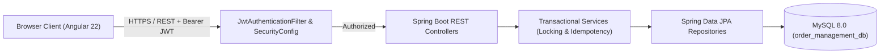
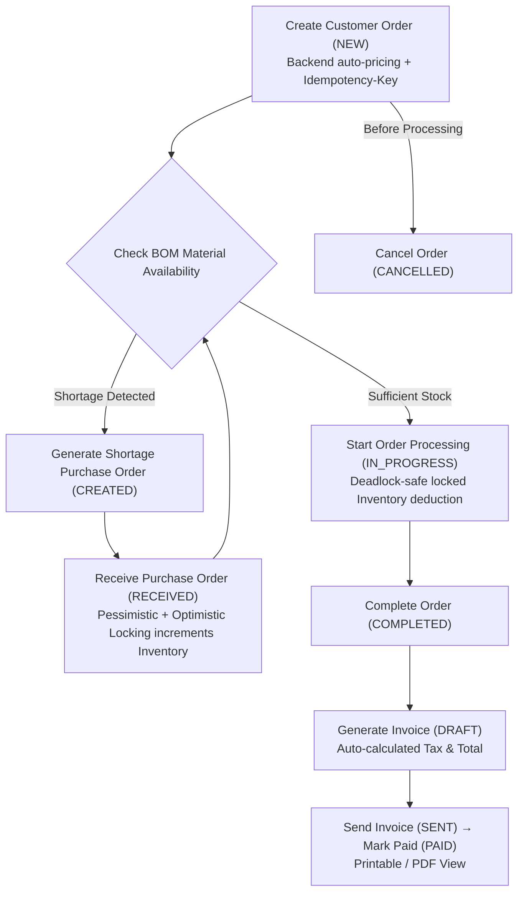
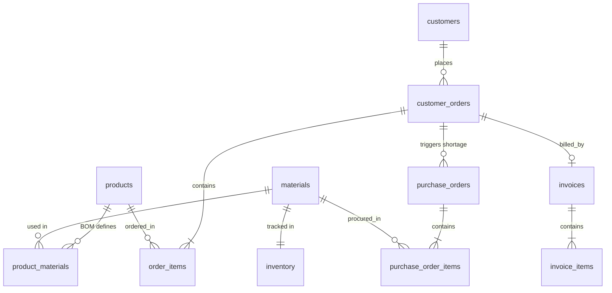

# OrderCraft — Order & Supply Chain Management System


**OrderCraft** is a full-stack **Order, Inventory, Procurement, and Invoicing Management System** built with **Spring Boot**, **Angular**, and **MySQL**. It manages the complete manufacturing and fulfillment lifecycle — from customer order intake and Bill of Materials (BOM) explosion to raw-material shortage procurement, locked inventory deduction, invoicing, and live operational analytics.

---

## Table of Contents

- [System Architecture](#system-architecture)
- [Core Workflows](#core-workflows)
- [Database Schema (ER Diagram)](#database-schema-er-diagram)
- [Role-Based Access Control (RBAC)](#role-based-access-control-rbac)
- [Feature Modules](#feature-modules)
- [API Reference](#api-reference)
- [Project Structure](#project-structure)
- [Getting Started](#getting-started)
- [Running Tests](#running-tests)

---

## System Architecture



---

## Core Workflows

### End-to-End Order-to-Invoice Lifecycle



---

## Database Schema (ER Diagram)



---

## Role-Based Access Control (RBAC)

OrderCraft enforces stateless **JWT authentication** with **BCrypt** password hashing and 4 operational roles across both backend endpoints and Angular route/UI guards:

| Module / Capability | `ADMIN` | `SALES_EXECUTIVE` | `INVENTORY_MANAGER` | `PROCUREMENT` |
| :--- | :---: | :---: | :---: | :---: |
| **Live Dashboard** (`/dashboard`) | ✅ | ✅ | ✅ | ✅ |
| **Customers** (`/customers`) | ✅ | ✅ | ❌ | ❌ |
| **Products & BOM** (`/products`) | ✅ Full | 👁️ Read | 👁️ Read | 👁️ Read |
| **Raw Materials** (`/materials`) | ✅ Full | ❌ | ✅ Full | 👁️ Read |
| **Inventory** (`/inventory`) | ✅ Full | 👁️ Read | ✅ Full | 👁️ Read |
| **Customer Orders** (`/orders`) | ✅ Full | ✅ Create / Edit / Cancel | 👁️ Read + Process / Complete | 👁️ Read + Shortage PO |
| **Purchase Orders** (`/purchase-orders`) | ✅ Full | ❌ | 👁️ Read + Receive | ✅ Create / Edit / Delete |
| **Invoices** (`/invoices`) | ✅ Full | ✅ Full | ❌ | ❌ |
| **User Management** (`/users`) | ✅ Full | ❌ | ❌ | ❌ |

---

## Feature Modules

1. **Live Dashboard & Operational Analytics (`/dashboard`)**
   - Real-time KPIs for orders, revenue, paid vs. outstanding invoices, procurement spend, and pending POs.
   - Automatic **Low Stock Alerts** (`quantityAvailable <= reorderLevel`), recent orders/invoices tables, and role-filtered quick actions.
2. **Customer Order Management (`/orders`)**
   - Multi-product order creation with **server-side price & total calculation** (`BigDecimal` rounding), duplicate line-item rejection, and `Idempotency-Key` header deduplication.
   - Interactive **5-step Order Processing Workflow Modal** showing BOM material requirements, live stock availability, shortage PO generation, locked inventory deduction, completion, and one-click invoice generation.
3. **Purchase Order & Procurement (`/purchase-orders`)**
   - Manual PO creation as well as automatic **shortage-aggregated PO generation** linked to customer orders (with duplicate active PO prevention).
   - Concurrency-safe receiving (`@Version` optimistic locking + `PESSIMISTIC_WRITE` row locks) to prevent double inventory increments.
4. **Products & Bill of Materials (`/products`)**
   - Product catalog management with active/inactive lifecycle (preserving historical inactive items when editing existing `NEW` orders).
   - Dedicated BOM modal for mapping required raw materials and quantities per product.
5. **Materials & Inventory (`/materials`, `/inventory`)**
   - Raw material master data with reorder thresholds and unit costs, plus live inventory stock tracking.
6. **Invoice Management (`/invoices`)**
   - One-to-one invoice generation from `COMPLETED` orders with configurable tax rates, due dates, and notes.
   - Status lifecycle (`DRAFT → SENT → PAID / OVERDUE / CANCELLED`) and **Print / Save PDF** support via `@media print` styling.
7. **Authentication & User Administration (`/login`, `/users`)**
   - First-run **Initial Admin Setup** when the `users` table is empty (automatically locked once an admin exists).
   - Admin user CRUD with role assignment and active/inactive status control.

---

## API Reference

| Area | Endpoints |
| :--- | :--- |
| **Auth** | `GET /api/auth/setup-status`, `POST /api/auth/setup-admin`, `POST /api/auth/login`, `GET /api/auth/me` |
| **Users** | `GET /api/users`, `POST /api/users`, `PUT /api/users/{id}`, `DELETE /api/users/{id}` |
| **Dashboard** | `GET /api/dashboard/summary` |
| **Customers** | `GET /api/customers`, `GET /api/customers/{id}`, `POST /api/customers`, `PUT /api/customers/{id}`, `DELETE /api/customers/{id}` |
| **Products & BOM** | `GET/POST/PUT/DELETE /api/products/**`, `GET/POST/PUT/DELETE /api/product-materials/**` |
| **Materials & Inventory** | `GET/POST/PUT/DELETE /api/materials/**`, `GET/POST/PUT/DELETE /api/inventory/**` |
| **Customer Orders** | `GET/POST/PUT/DELETE /api/orders/**`, `GET /api/orders/{id}/details`, `GET /api/orders/{id}/processing-summary`, `POST /api/orders/{id}/create-purchase-order`, `POST /api/orders/{id}/start-processing`, `POST /api/orders/{id}/complete`, `POST /api/orders/{id}/cancel` |
| **Purchase Orders** | `GET/POST/PUT/DELETE /api/purchase-orders/**`, `GET /api/purchase-orders/{id}/details`, `POST /api/purchase-orders/{id}/receive` |
| **Invoices** | `GET /api/invoices`, `GET /api/invoices/{id}`, `GET /api/invoices/order/{orderId}`, `POST /api/invoices?orderId={orderId}`, `PUT /api/invoices/{id}/status`, `DELETE /api/invoices/{id}` |

---

## Project Structure

```text
OrderCraft/
├── Order_Management_System/          # Spring Boot 4.1.1 Backend (Java 17)
│   ├── src/main/java/com/hcl/Order_Management_System/
│   │   ├── Config/                   # CORS configuration
│   │   ├── Controller/               # REST API controllers
│   │   ├── DTO/                      # Request & response models
│   │   ├── Exception/                # GlobalExceptionHandler & custom exceptions
│   │   ├── Model/                    # JPA entities
│   │   ├── Repository/               # Spring Data JPA repositories
│   │   ├── Security/                 # JWT service, filter & SecurityConfig
│   │   └── Service/                  # Transactional business logic
│   └── src/test/java/                # JUnit 5 + Mockito + SpringBootTest suite
│
└── order-management-frontend/        # Angular 22.2.0 Frontend (TypeScript)
    └── src/app/
        ├── guards/                   # authGuard, roleGuard, guestOnlyGuard
        ├── interceptors/             # JWT Bearer token interceptor
        ├── models/                   # TypeScript interfaces
        ├── pages/                    # Dashboard, Orders, POs, Invoices, Products, Materials, Inventory, Customers, Users, Login
        └── services/                 # Angular HTTP services
```

---

## Getting Started

### Prerequisites

- **Java 17+** (tested with JDK 17+)
- **Node.js 24+** & **npm 11+**
- **MySQL 8.0+** running on `localhost:3306`

### 1. Configure MySQL

Create the database (tables are created and updated automatically by Hibernate `ddl-auto=update`):

```sql
CREATE DATABASE IF NOT EXISTS order_management_db;
```

Update credentials in `Order_Management_System/src/main/resources/application.properties` if your MySQL username/password differs from the local defaults.

### 2. Run the Backend (`http://localhost:8080`)

```powershell
cd Order_Management_System
.\mvnw.cmd spring-boot:run
```

> **Tip:** To preserve JWT tokens across server restarts, set `ORDERCRAFT_JWT_SECRET` (at least 32 characters) in your environment before starting the backend:
> ```powershell
> $env:ORDERCRAFT_JWT_SECRET="replace-with-a-secure-32-plus-char-secret"
> ```

### 3. Run the Frontend (`http://localhost:4200`)

```powershell
cd order-management-frontend
npm install
npm start
```

### 4. First-Time Setup in the Browser

1. Open **`http://localhost:4200`**.
2. On first launch (when the `users` table is empty), the login screen automatically switches to **Initial Admin Setup** so you can create your first `ADMIN` account.
3. Once logged in, use **Users** (`/users`) to create accounts for `SALES_EXECUTIVE`, `INVENTORY_MANAGER`, and `PROCUREMENT` roles.

---

## Running Tests

### Backend Tests (JUnit 5 + Mockito + Spring Context)

```powershell
cd Order_Management_System
.\mvnw.cmd test
```

- **51 tests** covering Spring Boot context startup, JWT generation/validation, order pricing & idempotency, BOM processing & inventory locking, purchase order receiving, invoicing, user management, and dashboard analytics.

### Frontend Typecheck, Production Build & Unit Tests (Vitest)

```powershell
cd order-management-frontend
npx ngc --noEmit -p tsconfig.app.json
npm run build
npx ng test --watch=false
```

- **41 tests across 11 test files** covering all 10 page components (`App`, `Login`, `Dashboard`, `Customers`, `Products`, `Materials`, `Inventory`, `Orders`, `PurchaseOrders`, `Invoices`, `Users`).
